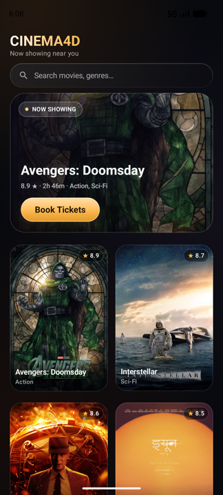
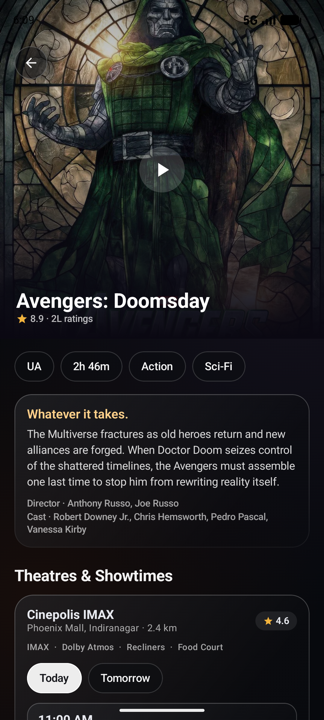
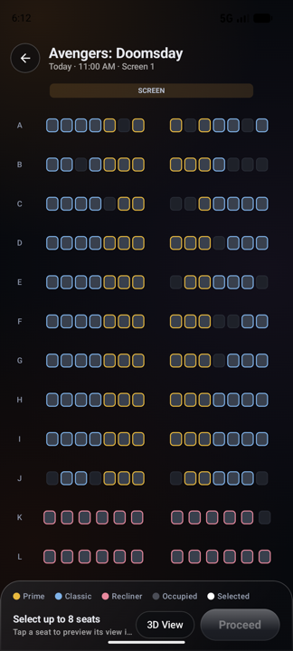
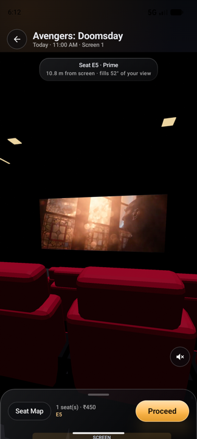
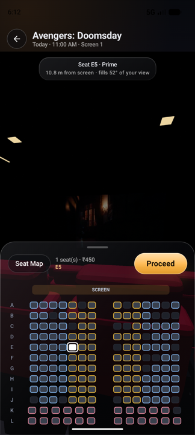
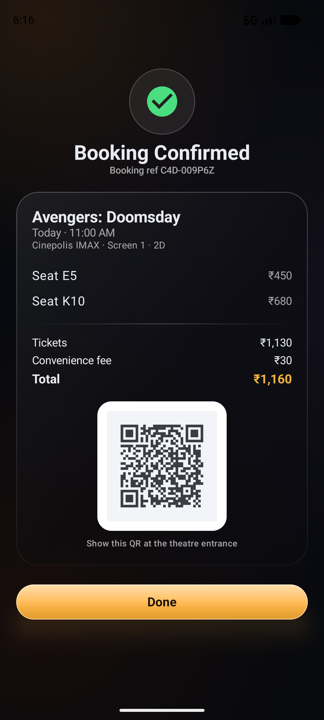

# Cinema4D

**This is the concept for a real seat booking experience.**

Booking a cinema ticket today means picking a coloured square on a grid and hoping for the best. Cinema4D asks a simpler question: what if you could *see* the seat before you paid for it?

Tap any seat on the map and the app drops you into the auditorium at that seat's eye position — a real 3D hall with rows of plush seats, aisle lighting and the movie's trailer playing on the screen. Drag to look around. Pick another seat and the camera flies there, rising over the rows. When it looks right, book it.

<br/>

<p align="center">
  
  
  
  
</p>

<p align="center">
  
  
</p>

## The idea

The seat preview is the whole product. Everything else — the browse screen, the showtimes, the seat map, the ticket — exists to get you to that moment and then get out of the way.

- **The view is the seat.** The camera sits at the seat's eye height, facing the screen, so distance and screen fill are honest. The chip at the top tells you exactly what you're getting: *"10.8 m from screen · fills 52° of your view."*
- **Look around.** Swipe to turn your head; pinch to lean in. The hall is lit like a real one — the screen is the key light, the ceiling has downlights, the aisles glow.
- **Seats fly, not cut.** Choosing another seat glides the camera across the hall with a slight arc over the rows, so you keep your sense of place.
- **Keep picking without leaving.** A glass sheet holds the full seat map inside the 3D view. Drag it up, tap a seat, and it slides away as the camera flies.

## What's in the app

| Screen | |
|---|---|
| Now showing | Real posters, search, featured hero |
| Movie detail | Synopsis, cast, theatres, dates, showtime formats |
| Seat map | 12 rows × 164 seats, tiered pricing, occupied seats, 8-seat cap |
| 3D seat view | The hall from your seat, trailer on screen, drag-to-look, audio toggle |
| E-ticket | Seat-wise fare, convenience fee, scannable QR |

Everything runs on local mock data. No login, no backend, no network calls at runtime — the trailers and posters ship inside the APK.

## How the 3D works

The auditorium is modelled procedurally in Blender (`tools/build_hall.py`) and exported as `hall.glb` alongside `seat_map.json`, which holds the eye coordinates for every seat. That JSON is the single source of truth — the 2D map and the 3D camera both read from it.

The app renders the hall with SceneView/Filament. The movie screen is a plane fed by a `MediaPlayer` through a `SurfaceTexture` and a Filament external stream, so the trailer plays inside the scene rather than behind a video view. Seats are upholstered with a bevel pass on the fabric pads, with glossy black shells and armrests, and the hall runs on warm ceiling pools, a cool screen spill and two rear fills — no image-based lighting, so it stays properly dark.

## Stack

- Kotlin, Jetpack Compose, Material 3
- SceneView 2.3.4 / Filament for the 3D hall
- Blender for the auditorium model, ffmpeg + yt-dlp for the trailer assets
- Coil for artwork, kotlinx.serialization for the seat map, ZXing for the ticket QR
- AGP 9.1, compileSdk 37, JDK 21, minSdk 26

## Build and run

```bash
./gradlew :app:assembleDebug
adb install -r app/build/outputs/apk/debug/app-debug.apk
```

Then: pick a movie → choose a showtime → tap a seat.

## Regenerating assets

```bash
# auditorium model + seat metadata
blender --background --python tools/build_hall.py -- \
  app/src/main/assets/models/hall.glb app/src/main/assets/seat_map.json

# posters and widescreen stills
python3 tools/fetch_movie_art.py

# launcher icon set
python3 tools/gen_icons.py
```

## Notes

This is a concept build, not a shipping product. Movie metadata, posters and trailers belong to their respective owners and are bundled only to demonstrate the experience. Payments, accounts and real seat inventory are out of scope.
